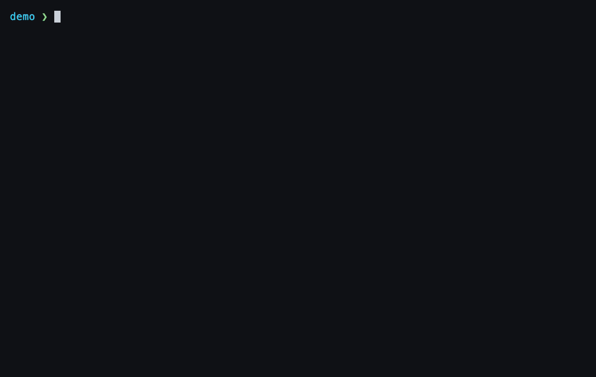

# Template syntax

A template is the command string with placeholders for the parts you fill in.
The syntax is deliberately tiny — three tokens — so there's no bespoke grammar
to learn.

## Tokens

| Token | Meaning |
|---|---|
| `<var>` | A **required** placeholder, prompted in the form. |
| `[ ... <var> ... ]` | An **optional segment** — if you skip the variable, the *entire bracketed fragment* is removed. |
| `\<` `\>` `\[` `\]` `\\` | Escaped literals — a real `<`, `>`, `[`, `]`, or `\`. |

## Required placeholders

`<var>` marks a value you must provide. The form prompts for it, and you can't
finish until it's filled:

```toml
tmpl = "git branch -D <branch>"
```

The name inside the angle brackets links the placeholder to its `[[cmd.var]]`
block (`name = "branch"`).

## Optional segments

This is Commando's signature move. Wrap a fragment **and its variable** in
`[...]`. If you skip the variable, the whole fragment — flag and all —
disappears:

```toml
tmpl = "git log [--author=<author>] [-n <count>] -- <file>"
```

| You do | Result |
|---|---|
| author = _skip_, count = `20`, file = `README.md` | `git log -n 20 -- README.md` |
| author = `alice`, count = _skip_, file = `a.go b.go` | `git log --author=alice -- a.go b.go` |
| author + count skipped, file = `x` | `git log -- x` |

Because the `--author=` text lives *inside* the bracket with its variable,
skipping the variable removes the flag too. **The dangling-flag problem simply
doesn't exist.**

Here it is in action — skipping an optional `[--exclude=…]` segment and
multi-selecting the required files, with the command preview assembling as you go:



<p class="gif-caption">The optional <code>[--exclude=…]</code> is skipped (it vanishes from the command), while two files are multi-selected and quoted.</p>

!!! tip "Optionality lives on the fragment, not the variable"

    A variable becomes optional by being inside `[...]`. The same variable
    outside brackets would be required. You can have multiple optional segments,
    and they can be nested.

## Shell syntax is kept verbatim

Most shell syntax that resembles a token is left alone, so you rarely need to
escape anything:

- `<` starts a placeholder only when a name character (letter, digit, `_`,
  `-`, `.`) directly follows it and a `>` closes the name. `sort < f`,
  `<<EOF`, `<<<word`, `<(cmd)`, and `2<&1` are literal.
- `[...]` is an optional segment only when it contains a variable.
  `grep '[0-9]+'` and an unclosed `[` are literal, and `[[ ... ]]` is always
  literal, so `[[ -f <f> ]]` is a shell test with a required `<f>`.
- A backslash escapes only `<`, `>`, `[`, `]`, and `\`. Any other backslash,
  such as `\t`, `\*.go`, or a line continuation, is kept as written.
- Whitespace in the template is preserved, including newlines and spaces
  inside quotes. The only whitespace removed is the doubled gap a skipped
  optional segment leaves behind.

Something that starts like a placeholder but is malformed is an error, so a
typo is reported instead of being placed on your prompt: `<bad name>` (a space
in the name) and an unterminated `<file` both fail to parse.

## Escaping literals

When you do need a literal token, for example `<name>` written out or a
bracketed fragment that contains a variable, escape it with a backslash:

```toml
# A literal "<id>" and a literal bracket around a variable:
tmpl = "echo \<id\> <value>"
tmpl = "grep '\[<level>\]' <file>"
```

| Escape | Produces |
|---|---|
| `\<` | `<` |
| `\>` | `>` |
| `\[` | `[` |
| `\]` | `]` |
| `\\` | `\` |

## How resolution works

At fill-in time, Commando walks the template left to right:

1. For each segment, determine the variable's value (candidate, default, typed,
   or remembered).
2. If a segment is optional and the variable is skipped, **omit the whole
   segment**.
3. Otherwise substitute the value in place.
4. Multi-select values are formatted with `each` and joined with `sep` before
   substitution (see [Variables](variables.md#multi-select-multi-each-sep)).

The [command preview](tui.md#stage-2-the-fill-in-form) shows this assembling in
real time as you fill the form.

## Next

<div class="grid cards" markdown>

-   :material-tune-variant: __[Variables](variables.md)__

    Give each placeholder candidates, defaults, multi-select, and more.

-   :material-brain: __[Argument memory](argument-memory.md)__

    How Commando remembers and ranks the values you enter.

</div>
